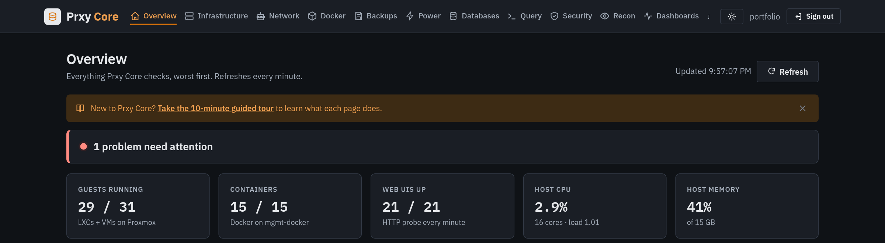
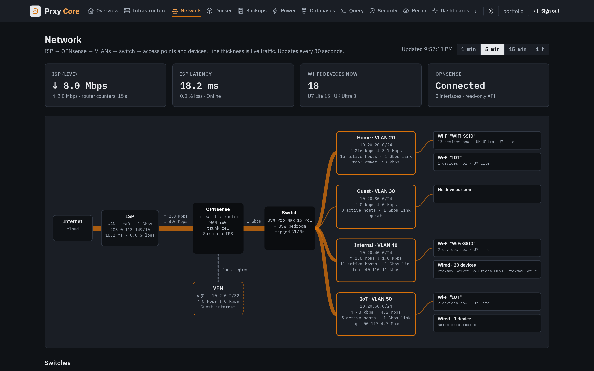
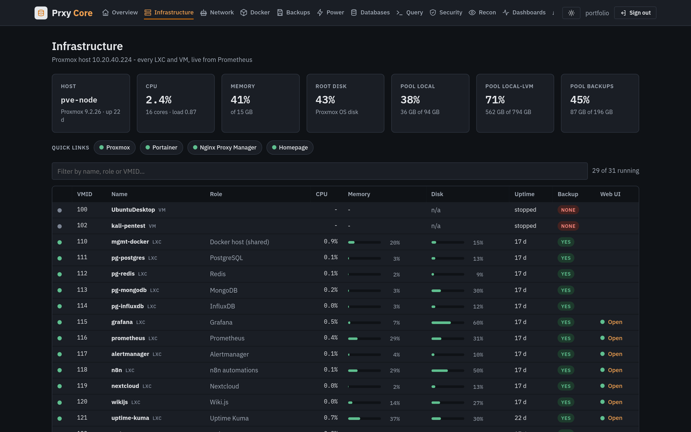
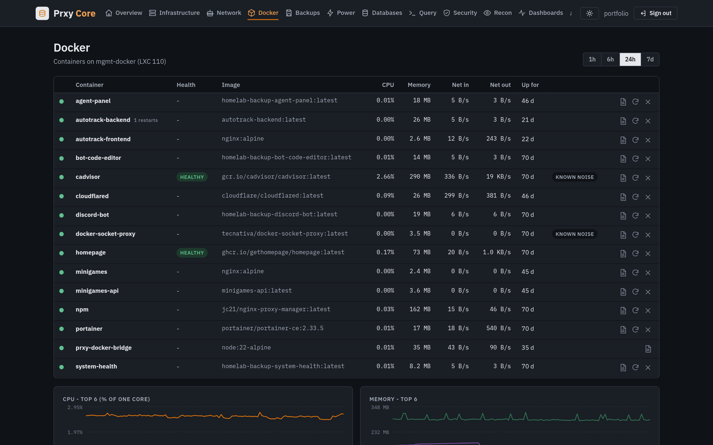
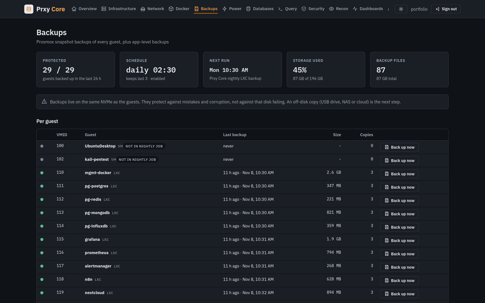
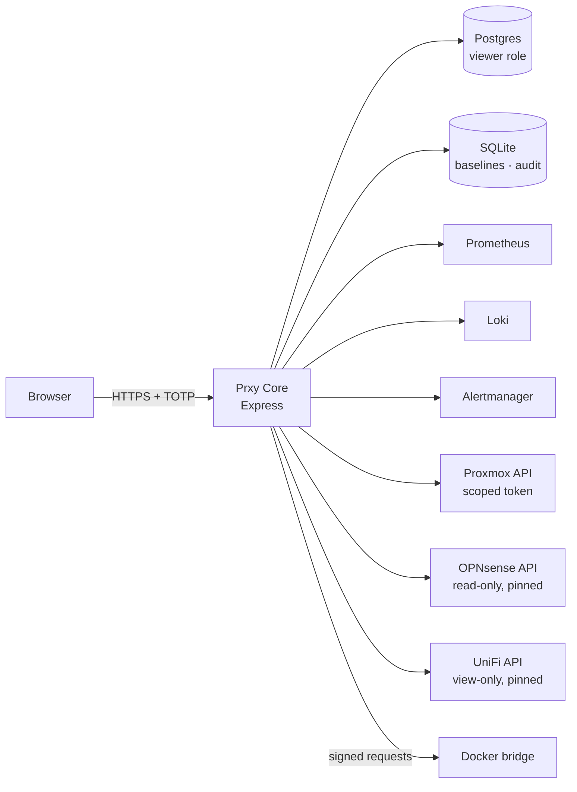

# Prxy Core

**One custom control center for my whole homelab.** It replaces a pile of separate tools (Grafana, CloudBeaver,
vendor dashboards) with a single app built around what I actually check every day: is everything up, is it
backed up, what changed on the firewall, and who is on the network.

> Node.js · Express · PostgreSQL · SQLite · Prometheus / Loki / Alertmanager · Proxmox VE API ·
> OPNsense API · UniFi API · TOTP · vanilla JS (no framework, no `innerHTML`)



| Network map: ISP → firewall → VLANs → Wi-Fi | Infrastructure: every LXC/VM |
|---|---|
|  |  |
| **Docker: health, logs, TOTP-gated restart** | **Backups: freshness per guest** |
|  |  |

<sub>Screenshots come from a read-only copy of my live instance. Addresses, Wi-Fi names, MACs and provider names are masked.</sub>

## Features
| Page | What it does |
|---|---|
| **Overview** | Red/amber/green status board across Proxmox, disks, backups, Docker, monitoring, web UIs and databases |
| **Infrastructure** | Host, storage pools, every LXC/VM with CPU/memory/disk/uptime and backup age; start/reboot/shutdown with TOTP |
| **Network** | Live VLAN map from NetFlow + UniFi, per-interface rates and gateway health from OPNsense, firewall policy matrix |
| **Firewall watch** | Baselines the live rule set and flags adds/edits/removals, **detects rules that can never match** (a catch-all above them), blocked-traffic history |
| **Security** | New-device detection, failed logins across apps, IDS pipeline health |
| **Recon / Exposure** | Daily check of my own domains: SPF/DMARC mail records, certificate expiry and names, public exposure |
| **Docker** | Container health, logs and restart through a separate signed-request bridge |
| **Databases** | Read-only Postgres browser and query console (single statement, read-only transaction, row and time caps) |
| **Backups / Power** | Nightly backup freshness and failures; UPS battery, load and runtime |

## Security model
- **Read-only by default.** Postgres via a `viewer` role (`pg_read_all_data`, `default_transaction_read_only`,
  statement timeout). OPNsense and UniFi through dedicated view-only accounts with **pinned TLS certificates**.
- **Step-up auth for every change:** password + TOTP to sign in, and a *fresh single-use* TOTP code for each state-changing
  action. Destructive actions also require typing the guest name. Everything is written to an audit log.
- **Scoped Proxmox token** with a custom role (VM power, backup, audit only), not root.
- Docker actions go through a **separate bridge container**: HMAC-signed requests, one allowed caller, and a fixed list of containers it may touch.
- Sessions stored hashed, `HttpOnly; Secure; SameSite=Strict`; CSRF header on writes; strict CSP; sensitive DB columns masked until revealed (reveals are audited).
- Runs as an unprivileged user under a hardened systemd unit; code is root-owned and read-only to the service.
- **Privacy:** identifying data (device/IP level) is kept 24 h, then rolled up into anonymous counts.

## Architecture


| Path | What |
|---|---|
| `server.js` | Express app, auth, routes |
| `lib/` | One module per data source (`pve.js`, `opnsense.js`, `unifi.js`, `fwwatch.js`, `exposure.js`, …) and the checks engine (`checks.js`) |
| `lib/network.js` | Static network description (example values in this public copy) |
| `bridge/` | Docker bridge container (signed requests, allow-list) |
| `deploy/` | Hardened systemd unit |
| `public/` | Single-page UI, light/dark theme |

## Running it
```bash
npm ci
cp .env.example .env    # fill in the integrations you have
set -a; . ./.env; set +a
node server.js          # first start logs a one-time setup token: use it to create the admin account + TOTP
```
Every integration is optional: pages for missing sources show what to configure.

## What I learned
- Least-privilege API design across very different vendors (Proxmox roles, OPNsense ACLs, UniFi view-only users).
- Firewall rule analysis: shadowed rules, rule-set drift, and how OPNsense re-numbers rules on save.
- Building secure web apps without a framework: CSP, CSRF, session handling, TOTP step-up, audit trails.
- Turning raw telemetry (NetFlow, syslog, metrics) into a few decisions a person can act on.

---
*Part of my homelab portfolio. See also [Prxy-AI Command](https://github.com/proxy9108/prxy-ai-command) and [homelab](https://github.com/proxy9108/homelab).*
